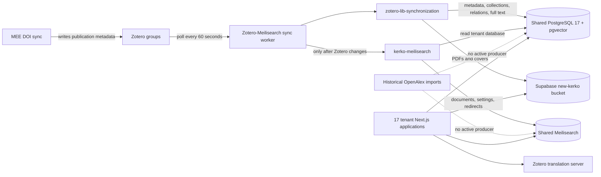

# Off limits: the `coolify` branch tenants

> This documents only the 17 live tenants that run the old Evidence Library from
> the `coolify` branch. They are off limits: never change, delete or clean them
> up. This is not how the current product works or will be deployed. Read it
> only when the user asks for work on these tenants.

Last verified: **2026-07-15** against the live Coolify control plane, the
Hetzner Docker host, PostgreSQL, Meilisearch, Zotero, and the deployed source
repositories.

This document records the deployed architecture of those tenants. It is
an operations reference for them, not a description of the current product.
Re-run the verification commands at the end before making decisions that
depend on live deployment state.

## Executive Summary

The platform consists of 17 tenant-specific Next.js frontends. Every frontend
uses the same `Openscholar-ai/evidence-community` image and connects to:

- One shared PostgreSQL/pgvector cluster, with a separate database per tenant.
- One shared Meilisearch service, with a separate index per tenant.
- One shared Zotero translation server.
- One shared Supabase bucket for published PDFs and cover images.

Fourteen tenants are maintained by one continuously running Zotero sync
worker. Three tenants are OpenAlex snapshots with no active refresh process.



## Coolify Topology

| Resource | Live value |
| --------------------------- | ----------------------------------------- |
| Coolify project | `new-el` — `qetrlcifc1p6311k0axma9zc` |
| Environment | `production` — `tyyrx6ddnnnrp9d5hko8outt` |
| Server | `localhost` — `q6fxt8zzt8g9ghlh8zol4r9u` |
| Destination | `h9x58n4acrwofryv1wyd6mjk` |
| Shared Docker network | `coolify` |
| Frontend repository | `Openscholar-ai/evidence-community` |
| Frontend branch | `coolify` |
| Deployed frontend revision | GitHub `coolify` branch HEAD |
| Frontend deployment trigger | GitHub webhook fan-out |

All 17 active frontends have the same deployment shape:

- Dockerfile build using `/Dockerfile` and the repository root as context.
- Internal application port `3000`.
- No persistent application storage.
- No application health check.
- No configured CPU or memory limit.
- A `feature-flags-sync` scheduled task every ten minutes.
- Internal connections to the shared Postgres, Meilisearch, and translation
  services through the `coolify` Docker network.

Coolify reports these applications as `running:unknown` because no health
check is configured. That state does not prove application failure or health;
the container and HTTP endpoint must be checked directly.

An abandoned `main`-branch application, `u3wusxfsb0dh5zh5ib37hjwl`, exists in
the separate `dev` project. It is `exited:unhealthy` and has no running
container.

## Tenant Deployment Map

| Tenant | App UUID | Public domains | Source | PostgreSQL database | Meili index | Documents | Live sync state |
| ---------------------- | -------------------------- | ----------------------------------------------------------------------- | ----------------- | ------------------- | -------------------- | --------: | --------------- |
| AdaptDev | `pbn7ushvbgzoq54i05f3f4yf` | `docs.adaptdev.info`, `docs-adaptdev.opendev.space` | Zotero `1265281` | `adaptdev` | `itemsAdaptdev` | 2,243 | Active |
| AIME | `wlwfykk1jb3rgp5v4q5td722` | `aievidencehub.org`, `www.aievidencehub.org`, `docs-aime.opendev.space` | Zotero `5515175` | `aime` | `itemsAime` | 992 | Active |
| Climate | `v12eholkfcg1zfzswrpyp19z` | `climate.educationevidence.io`, `docs-climate.opendev.space` | Zotero `5072953` | `climate` | `itemsClimate` | 1,900 | Active |
| EdTech Hub | `d7f5satn1o7knj53u9q1vq3z` | `docs.edtechhub.org` | Zotero `2405685` | `edtechhub` | `itemsEdtech` | 11,060 | Active |
| EEF | `q5vytqnl5pg3uup5bz9848iy` | `tech.eved.io`, `docs-eef.opendev.space` | Zotero `4820891` | `eef` | `itemsEef` | 161 | Active |
| eKitabu | `pq6us3hzbxv1v5lr8zol4cwl` | `evidence.ekitabu.com`, `docs-ekitabu.opendev.space` | Zotero `5724422` | `ekitabu` | `itemsEkitabu` | 386 | Active |
| Evidence Fund | `m16b40l83pabpi845ral77u8` | `evidencefund.com`, `www.evidencefund.com` | Zotero `5964260` | `fcdo` | `itemsFCDO` | 215 | Active |
| Implementation Science | `g3ksat38uodr095p6vycroe8` | `is.eved.io`, `docs-is.opendev.space` | Zotero `4869029` | `islibrary` | `itemsIs` | 1,024 | Active |
| Jimma | `uns4oamwg6thr4u8681bplbe` | `research-portal.ju.edu.et`, `docs-jimma.opendev.space` | OpenAlex snapshot | `ethiopia` | `itemsEthiopia` | 132,433 | No producer |
| Kaleidoscopio | `i7awlq7qp5hpovik1pdqsed7` | `library.kaleidoscopio.co.mz`, `docs-kaleidoscopio.opendev.space` | Zotero `2793607` | `programa` | `itemsPrograma` | 846 | Active |
| Kenya | `h5c6uj5bi6libicsd9nbdnln` | `research.ekitabu.com`, `docs-kenya.opendev.space` | OpenAlex snapshot | `kenya` | `itemsKenya` | 156,600 | No producer |
| Malawi | `gw603z2frkm3884hh6r9v4x2` | `malawi.educationevidence.io`, `docs-malawi.opendev.space` | Zotero `4752638` | `malawi` | `itemsMalawi` | 1,368 | Active |
| Mathlib | `rzvrelikcyn31i5q5zdxi9ro` | `docs.metea.org.uk`, `docs-mathlib.opendev.space` | Zotero `5168324` | `mathlib` | `itemsMathlib` | 472 | Active |
| Maths | `wagsbthq7gvrxz5yflegj30i` | `docs-maths.opendev.space` | OpenAlex snapshot | `maths` | `itemsMaths` | 1,439 | No producer |
| OpenDevEd | `jpz3rvlv5bwo5zwek6oa7kle` | `docs.opendeved.net` | Zotero `2129771` | `opendeved` | `itemsOpenDeved` | 8,590 | Active |
| Unlocking Data | `m8yb9d2oj1hptoow1rejgvao` | `docs.unlockingdata.africa` | Zotero `5578897` | `unlockingdata` | `itemsUnlockingData` | 836 | Active |
| USAID | `agreu01xnz5hpo1ccwj2uo99` | `edu-works.org` | Zotero `5954985` | `usaid` | `itemsUSAID` | 1,400 | Active |

Document counts are Meilisearch counts observed on 2026-07-15. They are not
the total number of PostgreSQL rows because only top-level library records
become Meilisearch documents.

## Application Data Flow

Each frontend chooses its tenant through one runtime manifest revision:

```text
services.database.url -> the active revision's PostgreSQL database
services.search.host  -> the library application's private Meilisearch service
services.search.index -> the index inside that private service
```

At runtime:

- Search, facets, sorting, and Meilisearch semantic search use the library's
  private Meilisearch service. Its task queue is not shared with another
  library.
- Status, user/authentication data, social collections, and page-level RAG
  embeddings use the tenant's PostgreSQL database.
- Direct publication pages, exports, AI publication reads and `/api/item/[key]`
  read the committed PostgreSQL record through the shared metadata projection.
  They do not wait for a search indexing receipt. React deduplicates reads within
  one render; item and citation responses are not retained across requests.
  The server-rendered page uses that record without an identical mount-time
  fetch. Public card links use Next.js automatic prefetching and its default
  zero dynamic stale time so client navigation fetches the current page.
  Collection ancestry reads follow only the record’s memberships and parents.
  Drafts, removed records and hidden-tagged records or attachments stay
  private.
- Published PDFs and cover images are served from the shared Supabase storage
  project.
- Citation conversion uses the shared Zotero translation server.
- Links between records ("cites" and "related") live in the `itemLink` table
  in the tenant's PostgreSQL database. Each directed link is stored once per
  owner: `origin` is `manual` (made in `/admin`) or `source:<connection>`
  (mirrored from a source such as Zotero `dc:relation`); readers show each
  linked record once. "Cited by" and "related to this
  record" are read with a reverse query, never copied onto the other record.
  The public item page, `/api/item/[key]` (`item.links`) and
  `/api/citations/[key]` read that table. Source-reported citation counts live
  in `itemCitationMetric`, keyed by item and source connection with an
  observation time. They are exposed separately because they can include works
  outside the library and overlap with library links. The record's `relations`
  JSON keeps relationship metadata such as `owl:sameAs`, not citation counts.
- Each tenant's application configuration controls branding, locale, analytics,
  feature flags, and public base URL.

### Relevant frontend source paths

| Concern | Source path |
| --------------------------------------------- | ---------------------------------------------------------------------------------------------------------------------------------------------------- |
| PostgreSQL connection pool | `src/db/index.ts` |
| Meilisearch client | `src/lib/meilisearch.ts` |
| Search and document filtering | `src/lib/search.ts`, `src/lib/actions.ts` |
| Item API and attachment download | `src/app/api/item/` |
| Record links and source citation metrics      | `src/lib/links/item-links.ts`, `src/lib/links/citation-metrics.ts`, `src/db/schema/tables/itemLink.ts`, `src/db/schema/tables/itemCitationMetric.ts` |
| Item page and attachment rendering | `src/app/[locale]/lib/[key]/page.tsx`, `src/components/features/newlib/ItemPage.tsx` |
| Application RAG/page embeddings | `src/lib/ai.ts`, `src/app/api/ai/` |
| Zotero translation-server client | `src/lib/citations.ts` |
| Supabase image rewrite | `next.config.mjs` |
| Runtime variables embedded by the image build | `Dockerfile` |

The producer implementation lives outside this repository:

| Concern | Repository and path |
| ---------------------------------------------- | --------------------------------------------------------- |
| Multi-tenant polling and orchestration | `OpenDevEd/zotero-meilisearch-sync/src/orchestrator.ts` |
| Worker image composition | `OpenDevEd/zotero-meilisearch-sync/Dockerfile` |
| Zotero incremental synchronization | `OpenDevEd/zotero-lib-synchronization/src/zotero-lib.ts` |
| PostgreSQL writes and PDF processing | `OpenDevEd/zotero-lib-synchronization/src/local-db/db.ts` |
| Meilisearch document construction and settings | `OpenDevEd/kerko-meilisearch/src/index.ts` |
| Optional PostgreSQL embedding backfill | `OpenDevEd/kerko-meilisearch/src/embeddings.ts` |

## Zotero Synchronization Pipeline

### Deployed worker

| Setting | Live value |
| --------------------- | -------------------------------------------------- |
| Coolify UUID | `imrma9c9u8baudrcl8k3yumb` |
| Repository | `OpenDevEd/zotero-meilisearch-sync` |
| Branch | `main` |
| Deployed commit | `812c36ed613f017403e56465711b80ebdc86d399` |
| Poll interval | 60 seconds |
| Typical full cycle | Approximately 60.5 seconds with no source changes |
| Bootstrap indexing | Disabled; normal no-change cycles skip Meilisearch |
| Target execution | Sequential |
| Meili embedding model | `text-embedding-3-small` |
| Supabase bucket | `new-kerko` |
| Health check | None |
| Persistent storage | None |

The worker image contains two repositories cloned during its Docker build:

| Dependency | Branch | Revision embedded in the live image |
| -------------------------------------- | --------- | ------------------------------------------ |
| `OpenDevEd/zotero-lib-synchronization` | `coolify` | `593da3b273a097daf6b7c03dd9541b1ab74881e5` |
| `OpenDevEd/kerko-meilisearch` | `coolify` | `b3936b77dfd52a48a5f7148de940c7a24e50421c` |

The Dockerfile clones branches rather than immutable commits. A future rebuild
can therefore contain different dependency revisions even when the outer
worker commit is unchanged.

### Active targets

The worker processes these 14 targets in this exact order:

1. eKitabu
2. OpenDevEd
3. EdTech Hub
4. Kaleidoscopio/Programa
5. Evidence Fund/FCDO
6. Unlocking Data
7. AdaptDev
8. AIME
9. Climate
10. Mathlib
11. EEF
12. Implementation Science
13. Malawi
14. USAID

### Per-target execution

For each target, the worker:

1. Removes any stale `/root/SKIP_INDEX` marker.
2. Writes a temporary `zotero-cli.toml` with the target's API key and Zotero
   group ID.
3. Runs `zotero-cli db --sync test` against the tenant database.
4. Incrementally requests Zotero changes using the stored item version.
5. Writes changed groups, items, collections, relations, attachments, and
   status information into PostgreSQL.
6. If Zotero reports no changes, `zotero-lib-synchronization` writes the
   hard-coded `/root/SKIP_INDEX` marker and Kerko is skipped.
7. If data changed, the worker runs `kerko-meilisearch/src/index.ts --sync`
   against the tenant database and index.
8. A target failure is logged and processing continues with the next target.

`BOOTSTRAP_INDEX` is `false`, so no-change targets skip Meilisearch immediately.
Setting it to `true` would force indexing for every target during only the first
cycle after a worker restart.

### PDF processing

An attachment is eligible when it:

- Is a child Zotero attachment.
- Has content type `application/pdf`.
- Has an MD5 value.
- Has `_publish`, `publishPDF`, or `ai-imported`, or its parent has
  `ai-imported`.

For eligible PDFs, the synchronizer:

1. Downloads the attachment from Zotero.
2. Extracts page-separated text using markers such as
   `**|| PAGE 1 ||**`.
3. Renders the first page as a PNG cover.
4. Uploads the PDF and cover to:

   ```text
   new-kerko/{groupId}/{parentKey}/{attachmentKey}/file.pdf
   new-kerko/{groupId}/{parentKey}/{attachmentKey}/cover.png
   ```

5. Stores the public URLs, extracted text, and cover dimensions in PostgreSQL.

Existing attachments with missing full text or covers are not automatically
bulk-reprocessed unless their Zotero record changes. A separate repair utility
exists in the synchronization repository but is not part of the deployed
worker command.

### Meilisearch indexing

After a Zotero change, Kerko reads the complete tenant database and:

- Converts top-level Zotero records into Meilisearch documents.
- Groups child records under `attachmentsData`.
- Splits stored PDF text into page objects under `fullTextPDFs`.
- Adds collection metadata and ancestry.
- Produces redirects for replaced or historical item keys.
- Uploads documents in chunks.
- Applies filterable, sortable, ranking, searchable, and embedder settings.

This is a full-database upsert, but it does not explicitly delete documents
that are absent from PostgreSQL. Zotero deletions normally remain represented
through a deleted marker.

PostgreSQL page-level embeddings and Meilisearch document embeddings are
different data products:

- Meilisearch's native OpenAI embedder supports semantic document search.
- PostgreSQL's `embeddings` table holds page chunks used by application-level
  RAG features.
- The deployed sync worker does not run Kerko's separate PostgreSQL embedding
  script.

## USAID Synchronization Recovery

USAID Zotero group `5954985` was added to the worker's `SYNC_TARGETS` on
2026-07-15. The first cycle synchronized the ten pending Zotero records and
rebuilt `itemsUSAID` without bootstrapping the other tenants.

| Check | Before recovery | After recovery |
| ----------------------------------- | --------------: | -------------: |
| PostgreSQL group version | 7 | 8 |
| PostgreSQL items version | 5690 | 5694 |
| Meilisearch documents | 1,400 | 1,400 |
| Meilisearch item `ZSKZRG4V` version | 5533 | 5692 |

The document count remained stable because the pending changes updated existing
records. Both document batches and the subsequent settings tasks completed
successfully.

## OpenAlex Snapshots

Jimma/Ethiopia, Kenya, and Maths identify their database group as OpenAlex
with `externalId=1` and `itemsVersion=0`. They are not Zotero libraries.

| Dataset | Last source-data timestamp | Current state |
| -------------- | -------------------------- | --------------- |
| Ethiopia/Jimma | 2025-09-08 | Static snapshot |
| Maths | 2025-10-20 | Static snapshot |
| Kenya | 2026-03-02 | Static snapshot |

No active OpenAlex Coolify application, scheduled task, host timer, cron job,
PM2 process, or producer container was found. The corresponding 2026-05-14
Meilisearch dates are migration/rebuild dates rather than source freshness.

## Meilisearch

| Setting | Live value |
| --------------------- | ----------------------------------------------------------- |
| Coolify UUID | `j3obz2j62ime6k8ugcpz2z88` |
| Internal endpoint | `http://meilisearch-j3obz2j62ime6k8ugcpz2z88:7700` |
| Public endpoint | `https://meilisearch.opendev.space` |
| Compose image | `getmeili/meilisearch:latest` |
| Running version | `1.43.1` |
| Persistent volume | `j3obz2j62ime6k8ugcpz2z88_meilisearch-data` → `/meili_data` |
| Volume usage | Approximately 53 GB |
| Meili database stats | 56.47 GB allocated, 34.19 GB used |
| Environment | Production, analytics disabled |
| File-descriptor limit | 65,536 |
| CPU/memory limits | None |

There are 23 indexes: 17 tenant indexes plus:

| Index | Documents | Purpose/state |
| -------------- | --------: | ----------------------------------- |
| `redirects` | 95,129 | Shared legacy/replacement redirects |
| `cache` | 34 | Shared cache index |
| `itemsSDG4` | 172,728 | No active frontend |
| `itemsTesting` | 382 | No active frontend |
| `itemsFull` | 0 | Empty |
| `itemsTest` | 0 | Empty |

Observed task history:

| Result | Count | Explanation |
| ----------------- | ----: | ------------------------------------ |
| Succeeded | 9,068 | Normal document and settings updates |
| Failed | 708 | See classification below |
| Queued/processing | 0 | Idle at inspection time |

The 708 failures are:

- 631 nonfatal `index_already_exists` failures caused by unconditional target
  index creation before successful document and settings updates.
- 75 historical Ethiopia `too_many_open_files` document failures from one
  batch. The service now has `nofile=65536`, and no current recurrence was
  found.
- Two diagnostic-test failures.

Kenya currently has no Meilisearch semantic embedder. Other tenant indexes use
`text-embedding-3-small`, but searchable fields and embedding template sizes
vary between older and newer indexes.

## PostgreSQL

| Setting | Live value |
| ------------------- | ---------------------------------------- |
| Coolify UUID | `h9z02h4m2swqsjykmjhrc0gj` |
| Internal endpoint | `h9z02h4m2swqsjykmjhrc0gj:5432` |
| Public TCP proxy | `178.63.162.33:5432` |
| Image | `pgvector/pgvector:pg17` |
| PostgreSQL version | `17.10` |
| pgvector version | `0.8.2` |
| Persistent volume | `postgres-data-h9z02h4m2swqsjykmjhrc0gj` |
| Volume usage | Approximately 23 GB |
| Maximum connections | 300 |
| TLS | Disabled |
| CPU/memory limits | None |
| Coolify backups | None configured |

All tenant databases share the same 18 application tables, including item,
collection, group, status, user/authentication, social-collection, and
embedding tables. The cluster contains 35 databases in total, so not every
database belongs to an active tenant.

Largest active tenant databases:

| Database | Approximate size | Main size driver |
| ----------- | ---------------: | -------------------------------------------------- |
| `opendeved` | 15 GB | Approximately 1.14 million RAG embedding rows |
| `fcdo` | 2.35 GB | Approximately 159,000 RAG embedding rows |
| `ethiopia` | 1.83 GB | Item metadata plus approximately 14,000 embeddings |
| `kenya` | 469 MB | OpenAlex item metadata |
| `edtechhub` | 219 MB | Metadata plus approximately 11,500 embeddings |
| `programa` | 120 MB | Metadata plus approximately 3,500 embeddings |

`status.databaseUpdatedAt` reflects sync activity for active Zotero targets.
`status.updatedAt` is not a reliable source-freshness signal because feature
flag synchronization also changes it.

## Supporting Services

### Zotero translation server

| Setting | Live value |
| ----------------- | ------------------------------------------ |
| Coolify UUID | `cca1kb1g0m10ag83x24o4lok` |
| Repository | `zotero/translation-server` |
| Branch | `master` |
| Pinned commit | `d88a8d5384456439962edfef129b14841b09af6d` |
| Internal endpoint | `http://translation-server:1969` |
| Public endpoint | `https://bib.opendev.space` |

The root endpoint returns `404` because this is an API service. That response
is expected. Evidence Library instances resolve the service per runtime
configuration revision from `services.zotero.translationUrl`; when omitted,
or temporarily unavailable, only generated citation formatting is disabled.

### MEE DOI sync

`mee-doi-sync` is adjacent to, but separate from, the evidence-library indexing
worker.

| Setting | Live value |
| --------------- | ------------------------------------------ |
| Coolify UUID | `f11716cgepj5vzaosjxp3sx8` |
| Deployed commit | `778ef3ca1eaa07b3767d898c2f3da96fbd000227` |
| Schedule | Daily at `00:00` |
| Command | `node dist/main.js run-once` |

It handles MEE DOI/Crossref/Zenodo work for eKitabu, Unlocking Data, Climate,
EdTech Hub, and OpenDevEd. When it writes publication metadata back to Zotero,
the regular Zotero sync worker observes the new item version and propagates it
to PostgreSQL and Meilisearch.

Evidence Fund/FCDO DOI work is a separate workflow and is not covered by this
scheduled worker.

## Known Operational Gaps

These are verified current-state gaps, ordered roughly by operational impact:

1. **The three OpenAlex libraries have no refresh path.** They are static
   snapshots with old source timestamps.
2. **No PostgreSQL backup is configured in Coolify.** The backup list is empty.
3. **No local Meilisearch dump exists.** `/meili_data/dumps` is empty; no
   external backup was visible during the audit.
4. **The shared services are single points of failure.** Every tenant depends
   on the same PostgreSQL and Meilisearch instances.
5. **The sync cycle now consumes its full interval.** The first verified
   fourteen-target no-change cycle took 60.5 seconds and therefore slept for
   zero milliseconds. A cycle that includes a Meilisearch update takes longer.
6. **The sync worker has no liveness signal.** It does not listen on its
   configured port, its public route returns `502`, and Coolify reports
   `running:unknown`.
7. **Images and embedded dependencies are not reproducibly pinned.** Meili uses
   `latest`, and the worker clones dependency branches during image construction.
8. **No resource limits are configured.** The applications, worker, Postgres,
   and Meilisearch can contend for the entire host.
9. **Expected Meili failures obscure real failures.** The unconditional
    `createIndex` call produces hundreds of failed tasks even when indexing
    succeeds.
10. **PDF processing is incomplete for some tenants.** Existing attachments are
    not bulk-backfilled when full text or covers are missing.
11. **PostgreSQL is publicly proxied without TLS.** This is the verified live
    configuration.

## Routing and Runtime Anomalies

Observed on 2026-07-15:

| Endpoint | Result | Comparison |
| --------------------------------- | --------------- | -------------------------------------------- |
| `docs-adaptdev.opendev.space/lib` | `502` | `docs.adaptdev.info/lib` returns `200` |
| `edu-works.org/lib` | `502` | USAID container is running |
| `research-portal.ju.edu.et/lib` | `403` | `docs-jimma.opendev.space/lib` returns `200` |
| `library.kaleidoscopio.co.mz` | TCP/443 timeout | Generated Kaleidoscopio domain returns `200` |

Container restart counts also warrant investigation:

- Kenya: 856
- OpenDevEd: 24
- EdTech Hub: 17
- USAID: 17
- AdaptDev: 2

All were running at inspection time. Restart counts alone do not identify the
cause; historical logs or the triggering deployment state should be inspected
before changing configuration.

## Verification Runbook

The Coolify CLI context used for this audit was `hetzner`.

### Inventory and application configuration

```bash
coolify context list --format json
coolify resource list --format json
coolify app get <application-uuid> --format json --show-sensitive
coolify app env list <application-uuid> --format json --show-sensitive
coolify app deployments list <application-uuid> --format json
coolify app storage list <application-uuid> --format json
```

### PostgreSQL

```bash
coolify database get h9z02h4m2swqsjykmjhrc0gj --format json --show-sensitive
coolify database storage list h9z02h4m2swqsjykmjhrc0gj --format json
coolify database backup list h9z02h4m2swqsjykmjhrc0gj --format json
```

Use read-only catalog and count queries through `psql` to verify database
sizes, extensions, group identity, item versions, status timestamps, and
embedding counts.

### Host containers and logs

```bash
ssh hetzner 'sudo -n docker ps --format "table {{.Names}}\t{{.Status}}\t{{.Image}}"'
ssh hetzner 'sudo -n docker inspect <container>'
ssh hetzner 'sudo -n docker logs --since 2h <container>'
ssh hetzner 'sudo -n docker volume inspect <volume>'
```

### Meilisearch

Using the live master key from Coolify, inspect:

```text
GET /health
GET /version
GET /stats
GET /indexes?limit=100
GET /indexes/:uid/settings
GET /tasks
GET /keys
POST /indexes/:uid/search
```

Classify Meilisearch failures by `error.code`; the raw failed-task count is not
a useful health signal because of the expected `index_already_exists` noise.

## Audit Boundaries

The 2026-07-15 audit was read-only. It changed no Coolify, Docker, PostgreSQL,
Meilisearch, Zotero, Supabase, DNS, or GitHub state. Credentials were inspected
where necessary to trace live connections but are not duplicated in this
document; Coolify remains their source of truth.
