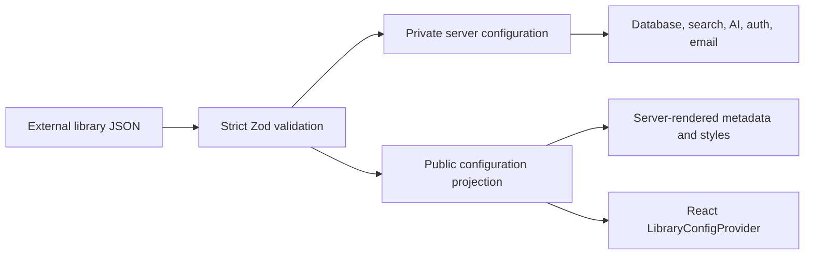

# Evidence Library local runtime-customization plan

## Outcome

Make one Evidence Library build capable of rendering every approved library
configuration. Changing a library must require publishing a configuration
revision, not rebuilding the application.

This plan implements the configuration boundary locally first. OpenScholar is
not involved.

## Local source of truth

Use one external JSON document selected by the server-only
`LIBRARY_CONFIG_PATH` environment variable.

- Track `config/library.example.json` as the complete documented example.
- Ignore `config/library.local.json`; this is the developer's editable local
  configuration.
- Default `LIBRARY_CONFIG_PATH` to `config/library.local.json` in development.
- Require an explicit path in production.
- Never import the JSON into application code. Read it from the filesystem at
  request time so Next.js cannot bundle it during `next build`.
- Cache the last valid parsed revision in-process and compare the file
  modification time before re-reading it.
- An invalid replacement never becomes active. In development it returns a
  detailed configuration error; in production the last valid revision remains
  active and readiness reports the rejected revision.
- A new valid revision becomes visible on the next full request. Existing open
  tabs update after reload; no application rebuild is required.



## Architectural decisions

1. `src/config/library-config/schema.ts` owns the strict Zod schema and all
   cross-field activation rules.
2. `src/config/library-config/source.ts` is the only filesystem reader.
3. `src/config/library-config/server.ts` exposes the complete validated
   configuration only from server code.
4. `src/config/library-config/public.ts` creates the serializable public
   projection and proves that credentials cannot reach the browser.
5. `src/context/LibraryConfigProvider.tsx` is the only client-side
   configuration context.
6. Server Components and route handlers read the server configuration
   directly. Client Components use `useLibraryConfig()`.
7. Next.js `connection()` marks the application shell as intentionally dynamic
   before runtime configuration is read. `NEXT_PUBLIC_*` is not used for
   library configuration.
8. All supported translation bundles stay compiled into the image. Runtime
   configuration only enables, orders, and selects from that fixed catalog.
9. Arbitrary remote library assets use stable public URLs and native browser
   elements or metadata links. They do not depend on `next/image` host
   allowlists.
10. PostgreSQL, Meilisearch, PostHog, AI, authentication, and email clients are
    created by revision-aware factories. They are not module-load singletons.
11. The PostgreSQL `status` row remains content/sync status only. It stops
    carrying branding, navigation, footer, legal, or feature configuration.
12. PostHog remains analytics. It stops being a configuration or feature-flag
    authority.
13. Gap-map source URLs remain external. A runtime route handler proxies the
    configured document through `/gapmaps/{slug}.html`.
14. Configuration activation is atomic: every field and dependency must pass
    before any part of the new revision is used.

## Mandatory Claude Code review gate

Every numbered implementation commit has the same completion gate:

1. Implement only that step.
2. Run the step's stated verification.
3. Invoke Claude Code with the `claude-fable-5` model in read-only plan mode.
4. Give Claude the step's scope, acceptance criteria, test output, and exact
   diff since the previous accepted step.
5. Fix every blocking or important finding and rerun verification.
6. Invoke Claude again after review-driven changes.
7. Advance only when Claude reports no remaining blocking or important
   findings.

Review command shape:

```bash
claude -p \
  --model claude-fable-5 \
  --effort high \
  --permission-mode plan \
  --no-session-persistence \
  "Review completed implementation step N. Do not edit files. Inspect the exact diff, tests, architecture, security boundaries, and acceptance criteria. Return findings ordered by severity with file and line references. Say explicitly when there are no blocking or important findings."
```

Claude review is additional verification. It never replaces lint, type-check,
unit, integration, browser, or one-build runtime checks.

Until the pre-existing repository lint baseline is repaired, a step's lint
gate is `npx eslint <every lintable file changed by the step>`. The full
`npm run lint` error and warning counts must also be included in that step's
Claude review input, and neither count may increase from the previous accepted
step. Commit 20 owns repair of every remaining baseline lint error. Commits 20
and 21 cannot complete until the full repository lint command passes with no
errors.

## Implementation commits

Each commit must leave the application buildable and locally runnable.

### 1. Add behavioral test foundations

- Add Vitest for schema, loader, projection, and service-factory tests.
- Add Playwright for full application/runtime checks.
- Add `test`, `test:unit`, and `test:e2e` scripts.
- Add one existing-behavior smoke test before changing configuration.

Verification: lint, type-check, the initial unit test, and the smoke test pass.

### 2. Define the complete configuration contract

- Implement the 140-field strict Zod schema from the approved customization
  map.
- Split reusable schemas for IDs, stable URLs, internal links, colors, tags,
  fonts, icons, and secrets.
- Implement every dependency rule in one schema refinement layer.
- Export inferred public and server types; do not maintain handwritten
  duplicate interfaces.
- Add valid, minimal, maximal, and invalid fixtures.

Verification: table-driven tests cover every field group and every cross-field
rule.

### 3. Add the local file source and validation command

- Add the external file loader with the 1 MiB limit, modification-time check,
  revision cache, and last-valid behavior.
- Add `npm run config:validate -- <path>`.
- Add the complete tracked example and ignored local configuration.
- Add a revision-only health response containing `schemaVersion`, `revision`,
  `updatedAt`, active/rejected state, and no private values.

Verification: editing the file changes the reported revision without running
`next build`; invalid JSON and invalid dependencies are rejected.

### 4. Establish private and public configuration APIs

- Implement the private server accessor.
- Implement an explicit public projection allowlist.
- Add the client provider and `useLibraryConfig()` hook.
- Pass the public projection from the root server layout into the provider.
- Mark the request boundary dynamic with `connection()`.

Verification: public-projection tests prove that database, search, AI,
authentication, and email secrets never appear in serialized HTML or JSON.

### 5. Move identity and metadata to runtime configuration

- Generate title, description, canonical URL, favicon, and icon metadata from
  the active revision.
- Replace name-derived repository logo paths with configured URLs.
- Apply configured logo CSS directly to the navbar and footer logo elements.
- Render funding partners from the configured ordered list.
- Delete manifest-name duplication and the PWA display branch.

Verification: two fixtures render different names, logos, favicons, base URLs,
funders, and logo CSS from the same build.

### 6. Convert theme, layout, and fonts to runtime tokens

- Replace build-generated tenant colors with stable Tailwind tokens backed by
  CSS custom properties.
- Generate the required color ramps from validated runtime colors.
- Move `small`/`wide`, default mode, and forced mode into the public
  configuration.
- Replace `next/font` tenant selection with runtime Google Fonts CSS or a
  configured WOFF2 `@font-face`.
- Only expose weights supported by the selected font families.
- Remove application imports from `tailwind.config.ts`.

Verification: theme fixtures exercise both layouts, both color modes, all
semantic colors, Google Fonts, WOFF2, and forced-mode/switcher exclusion.

### 7. Move institutions and uploaded icons to runtime data

- Replace the hardcoded institution-logo component map with configured
  `{id, name, logoUrl}` records.
- Add one reusable runtime asset renderer for logos and SVG/PNG/ICO navigation
  icons.
- Support either a platform icon ID or a stable uploaded icon URL.
- Remove bundled customer institution and navigation assets once no consumer
  remains.

Verification: institution logos and both icon modes render without changing
source files or image-host configuration.

### 8. Unify navigation, footer, contact, and legal configuration

- Replace `status.links`, `externalLinks`, `companyFooter`, and the external-nav
  fetch with the typed configuration sections.
- Render generic ordered footer sections, funders, disclaimer, attribution,
  social links, contact details, and legal links.
- Replace the EdTech Hub footer branch with data.
- Delete the unused documentation-link field and all customer-name branches.

Verification: small and complex footer fixtures produce the expected links and
sections; the external-nav source is no longer read.

### 9. Make localization selection runtime-controlled

- Keep the complete supported locale catalog in routing and in the built
  message bundles.
- Validate requested locales against the active configuration in the proxy.
- Redirect disabled locales to the configured default locale.
- Drive locale detection, locale order, default locale, and switcher
  visibility from configuration.
- Delete message override and external-bundle code.

Verification: enabled locales work, disabled locales redirect, the default is
honored, and the switcher appears only with at least two enabled locales.

### 10. Move search, filters, tags, and citations

- Replace search-related environment checks with typed runtime capabilities.
- Resolve scopes and the default scope from the approved platform catalog.
- Move institution, country, collections, and year-filter behavior into
  configuration.
- Replace singular tag constants with list-aware semantic helpers.
- Use the configured citation URL toggle everywhere citations are rendered or
  copied.
- Keep item-note explanatory copy in the compiled translations.

Verification: tests cover disabled search fields, default scopes, filter
dependencies, overlapping invalid tag lists, and citation URL output.

### 11. Replace PostHog feature flags with configuration

- Create a typed feature selector over the `features` object.
- Rename existing call sites to the approved feature IDs.
- Enforce dependencies at schema activation rather than scattering checks
  throughout components.
- Delete PostHog flag synchronization, database storage, cron route, and sync
  tooling.

Verification: each configured feature can be independently exercised, and
invalid parent/child combinations cannot activate.

### 12. Move collections and exports

- Apply configured collection title, enabled state, and order to live database
  collections.
- Reject configured collection IDs that do not exist.
- Move RIS, BibTeX, and Atom endpoints into the server configuration.
- Gate download/feed controls on the corresponding configured endpoint.
- Remove per-index collection profiles from `config.json`.

Verification: collection fixtures change presentation without changing the
database, and missing collection/export dependencies fail activation.

### 13. Replace bundled gap maps with the runtime proxy

- Read gap-map labels, descriptions, slugs, and external source URLs from
  configuration.
- Add the same-site route handler that streams the configured HTML response
  with its correct content type.
- Remove the build-time index rewrite, directory scan, label maps, description
  maps, and bundled tenant gap-map files.

Verification: `/gapmaps/{slug}.html` serves the configured external document;
unknown or disabled slugs return 404.

### 14. Introduce the revision-aware PostgreSQL factory

- Move schema exports away from the current module-level database singleton.
- Build Drizzle clients from `services.database.url`.
- Key the pool/client registry by active revision and dispose replaced pools.
- Migrate read-only query modules in small domain batches.
- Migrate write, user, and authentication query modules in small domain
  batches.
- Delete `DATABASE_URL_POST`, pool-size configuration, and the old global
  singleton.

Verification: database integration tests run against the configured URL, and a
revision change does not reuse the previous connection pool.

### 15. Introduce the revision-aware Meilisearch factory

- Build Meilisearch clients from the configured host and key.
- Resolve the configured index in one service boundary.
- Migrate search, citations, redirects, caches, feeds, sitemaps, and AI search
  consumers.
- Remove `MEILISEARCH_HOST`, `MASTER_KEY`, `MEILI_INDEX`, and all
  `config.json` index fallbacks.

Verification: every search request uses the configured index; two revisions do
not share tenant index state.

### 16. Move the Zotero translation service

- Build citation translation requests from
  `services.zotero.translationUrl`.
- Disable only the translation-dependent behavior when the optional service
  is absent.
- Remove `ZOTERO_TRANSLATION_SERVER_URL`.

Verification: configured and absent-service cases behave explicitly.

### 17. Make AI providers runtime-configurable

- Replace hardcoded provider and model arrays with provider factories.
- Instantiate only enabled providers with their configured server-side key.
- Resolve default, large, and small models from the platform-owned catalog.
- Drive AI, AI search, deep research, and embeddings through the validated
  dependency graph.
- Move prompt slots and processing rules out of `config.json`.

Verification: model selection cannot cross providers, disabled providers are
unavailable, and no API key reaches the browser.

### 18. Move analytics, authentication, and email

- Initialize browser and server PostHog from the active analytics section.
- Initialize Google Analytics from the configured measurement ID and duration.
- Build the NextAuth provider set only when login is enabled.
- Require complete Google credentials when Google login is enabled.
- Hide and reject login/user-collection routes when login is disabled.
- Build Nodemailer transports from the email section only when email is
  enabled.

Verification: login, Google login, user collections, PostHog, GA, contact, and
takedown behavior each match their dependency rules.

### 19. Move generation and processing behavior

- Drive sitemap, redirects, static-page behavior, rule lists, priorities, and
  prompt slots from configuration.
- Keep runtime rendering as the only customer path; no configuration value may
  trigger a customer-specific build.
- Replace free-form legacy rule arrays with the approved typed operations.

Verification: generation toggles affect runtime routes only, and invalid
operations or prompt variables fail configuration activation.

### 20. Delete every superseded customization path

- Delete `src/constants/config.json`.
- Delete customer-specific status columns and add a destructive database
  migration that drops them.
- Delete external-nav, PostHog-feature-flag, build-asset, and customer-branch
  code.
- Delete unused tenant logos, icons, institution images, and bundled gap maps.
- Remove customer build arguments from the Dockerfile.
- Remove customer-dependent rewrites and image hosts from Next configuration.
- Remove every library-specific `NEXT_PUBLIC_*` read and fallback.
- Keep only deployment bootstrap variables such as `LIBRARY_CONFIG_PATH` and
  platform process settings.
- Repair every remaining repository lint error and make `npm run lint` pass
  before this cleanup commit is accepted.

Verification: repository searches find no old configuration reads, customer
names, customer asset directories, or tenant-specific branches.

### 21. Prove the one-build contract

- Build the application exactly once.
- Start that build with two materially different configuration fixtures.
- Verify identity, metadata, theme, fonts, navigation, localization, search,
  tags, features, collections, gap maps, services, and integrations.
- Replace the active configuration atomically while the server is running and
  verify the next full request uses the new revision.
- Run lint, type-check, unit tests, integration tests, and browser tests.
- Document the local edit/validate/activate/reload workflow.

Verification: both libraries and a live revision change pass using the same
`.next` output and the same container image.

## Coverage of the approved catalog

| Configuration group | Fields | Implementation commits |
| --- | ---: | --- |
| Identity and branding | 14 | 5, 7 |
| Theme and layout | 15 | 6 |
| Navigation and footer | 19 | 8 |
| Localization | 4 | 9 |
| Search and filters | 15 | 10 |
| Content and citations | 7 | 10 |
| Feature switches | 17 | 11 |
| Collections and exports | 12 | 12, 13 |
| Runtime services | 5 | 14–16 |
| AI providers | 7 | 17 |
| Analytics, auth, and email | 16 | 18 |
| Generation and processing | 9 | 19 |
| **Total** | **140** | **All covered** |

## Testing decisions

- Test observable behavior and serialized configuration, not internal function
  structure.
- Every schema dependency receives one passing and one failing test.
- Public projection tests use sentinel secrets and assert that none appear in
  browser-visible output.
- Service tests assert revision isolation.
- Component tests cover generic renderers rather than customer fixtures.
- Browser tests cover both desktop and mobile for two contrasting library
  fixtures.
- The final one-build test is mandatory; a successful static build alone does
  not prove runtime configurability.

## Out of scope

- OpenScholar UI or APIs.
- Supabase upload flows.
- Central multi-library persistence or provisioning.
- DNS, deployment creation, billing, quotas, or organizations.
- Changes to Zotero/Meilisearch synchronization workers.
- Live editing inside an already-open browser tab; reload is the activation
  boundary.

## Completion rule

The work is complete only when the same build renders both test libraries,
accepts a new valid revision without rebuilding, rejects an invalid revision
atomically, exposes no private configuration to the browser, and contains no
remaining customer-specific configuration path.
